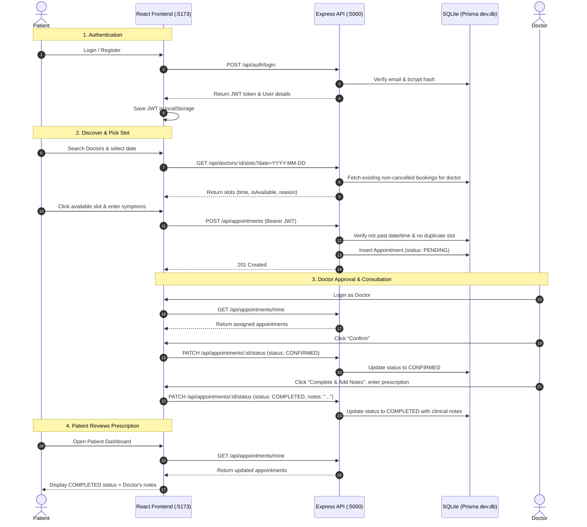

# 🏥 CareSync - Healthcare Appointment Portal

A complete, fullstack healthcare appointment scheduling and consultation portal designed for college projects and technical demonstrations. Built from scratch with a decoupled architecture, local SQLite database storage (zero database server configuration needed), JWT role-based authentication, and a modern, responsive UI.

---

## 📌 Table of Contents
1. [Project Overview](#-project-overview)
2. [Complete Tech Stack Breakdown](#-complete-tech-stack-breakdown)
3. [System Architecture & Directory Structure](#-system-architecture--directory-structure)
4. [Prerequisites & System Requirements](#-prerequisites--system-requirements)
5. [Step-by-Step Setup & Installation](#-step-by-step-setup--installation)
6. [Demo Login Credentials & Seeded Accounts](#-demo-login-credentials--seeded-accounts)
7. [How the System Works (End-to-End Workflow)](#-how-the-system-works-end-to-end-workflow)
8. [Database Schema & Data Models](#-database-schema--data-models)
9. [Core Business Logic & Backend Enforcements](#-core-business-logic--backend-enforcements)
10. [Comprehensive REST API Reference](#-comprehensive-rest-api-reference)
11. [College Viva & Demo Walkthrough Script](#-college-viva--demo-walkthrough-script)
12. [Troubleshooting & FAQs](#-troubleshooting--faqs)

---

## 🌟 Project Overview

CareSync solves common real-world scheduling hurdles in primary healthcare clinics. It bridges patients seeking specialized care with licensed doctors:
- **Patients** can search doctors by specialty, explore credentials and consultation fees, view dynamic real-time slot availability, reserve appointments, monitor status, and review physician clinical prescriptions and notes.
- **Doctors** get an interactive clinical dashboard to review incoming appointment requests, confirm or decline visits, manage daily schedules, and write detailed diagnosis notes upon completing consultations.
- **Strict Backend Constraints**: Enforces zero double bookings, blocks reservations for past dates and times, permits cancellations only prior to the scheduled consultation time, and restricts data visibility to authorized owners.

---

## 💻 Complete Tech Stack Breakdown

### 1. Frontend Client (`http://localhost:5173`)
| Technology / Library | Version | Purpose & Implementation Details |
| :--- | :--- | :--- |
| **React** | `v19` | Declarative component-based UI library powering interactive client rendering and state management. |
| **Vite** | `v8` | Next-generation frontend build tool providing ultra-fast HMR (Hot Module Replacement) and optimized production bundles. |
| **React Router DOM** | `v7` | Client-side routing library managing single-page navigation, browser history, and protected route wrappers. |
| **Tailwind CSS** | `v4` | Utility-first CSS styling engine configured via `@tailwindcss/vite` for modern cards, gradients, modals, and responsive layouts. |
| **Lucide React** | `v1` | Lightweight, scalable SVG medical and interface icons. |
| **Context API** | Built-in | Global application state management handling authentication (`AuthContext`) and floating notification alerts (`ToastContext`). |
| **Native Fetch API** | Built-in | Centralized HTTP client (`apiClient.js`) that automatically injects JWT bearer tokens from `localStorage` into request headers. |

### 2. Backend Server (`http://localhost:5000`)
| Technology / Library | Version | Purpose & Implementation Details |
| :--- | :--- | :--- |
| **Node.js** | `>= v18` | Asynchronous JavaScript runtime environment. |
| **Express.js** | `v4.21` | Minimalist HTTP web framework handling routing, REST endpoints, and request middleware. |
| **Prisma ORM** | `v5.22` | Modern, type-safe Object-Relational Mapper that executes schema migrations, models relationships, and runs database queries. |
| **JSON Web Tokens (`jsonwebtoken`)** | `v9.0` | Secure stateless user session management via signed JWTs valid for 7 days. |
| **bcryptjs** | `v2.4` | Salted password hashing algorithm (10 salt rounds) ensuring secure credential storage. |
| **cors** | `v2.8` | Cross-Origin Resource Sharing middleware configured to allow communication between `localhost:5173` and `localhost:5000`. |
| **dotenv** | `v16.4` | Environment variable management loading configurations from `.env` files. |
| **nodemon** | `v3.1` | Development utility that automatically restarts the Node server upon code changes. |

### 3. Database Layer
| Technology | Implementation Details |
| :--- | :--- |
| **SQLite (via Prisma)** | Embedded serverless database stored as a single local file (`server/dev.db`). Requires **zero external database installations**, Docker containers, or cloud database credentials. Works out of the box on any Windows, macOS, or Linux machine. |

### 4. Development Orchestration
| Tool | Purpose |
| :--- | :--- |
| **Concurrently** (`v9.1`) | Runs both the Express backend and the Vite frontend concurrently in a single terminal with colored output prefixes (`[SERVER]`, `[CLIENT]`). |

---

## 📁 System Architecture & Directory Structure

```text
fsd-mini-project/
├── package.json              # Root package with concurrently scripts
├── .env.example              # Environment variables template
├── README.md                 # Project documentation
│
├── server/                   # Backend Express application
│   ├── package.json          # Backend dependencies & scripts
│   ├── .env                  # Backend environment settings
│   ├── dev.db                # SQLite database file (created after prisma push / seed)
│   ├── prisma/
│   │   ├── schema.prisma     # Prisma Data models (User, DoctorProfile, Appointment)
│   │   └── seed.js           # Automated seeding script for demo data
│   └── src/
│       ├── server.js         # Express app entrypoint, CORS & route registration
│       ├── prisma.js         # Singleton Prisma client instance
│       ├── middleware/
│       │   └── auth.js       # JWT validation & role-based route guard middleware
│       ├── controllers/
│       │   ├── authController.js        # Register, login, and profile fetching
│       │   ├── doctorController.js      # Doctor directory search & dynamic slot calculation
│       │   └── appointmentController.js # Appointment booking, status transitions & cancellation
│       └── routes/
│           ├── authRoutes.js        # /api/auth routes
│           ├── doctorRoutes.js      # /api/doctors routes
│           └── appointmentRoutes.js # /api/appointments routes
│
└── client/                   # Frontend React + Vite application
    ├── package.json          # Frontend dependencies & scripts
    ├── vite.config.js        # Vite config with Tailwind CSS & API proxy (/api -> :5000)
    ├── index.html            # HTML entry point with title and favicon
    └── src/
        ├── main.jsx          # React DOM root render
        ├── App.jsx           # Master route registry & layout container
        ├── index.css         # Tailwind CSS styling and global typography
        ├── api/
        │   └── apiClient.js  # Reusable fetch client with auth headers and error handling
        ├── context/
        │   ├── AuthContext.jsx   # Global user authentication state
        │   └── ToastContext.jsx  # Floating notification toast provider
        ├── components/
        │   ├── Navbar.jsx         # Responsive navbar with role badge & navigation links
        │   ├── Footer.jsx         # Footer with medical disclaimer and project details
        │   └── ProtectedRoute.jsx # Client route guards for PATIENT and DOCTOR roles
        └── pages/
            ├── Home.jsx             # Landing page with hero, specialties, and doctor previews
            ├── Login.jsx            # Sign-in page with 1-click evaluation demo buttons
            ├── Register.jsx         # Registration page for both Patients and Doctors
            ├── Doctors.jsx          # Doctor search & filter directory
            ├── DoctorProfile.jsx    # Doctor profile, date picker, real-time slots & booking modal
            ├── PatientDashboard.jsx # Patient booking history, cancellation & clinical notes
            └── DoctorDashboard.jsx  # Doctor schedule, approval queue, and clinical notes editor
```

---

## ⚙️ Prerequisites & System Requirements

- **Node.js**: `v18.x`, `v20.x`, `v22.x`, or `v24.x` installed.
- **npm**: `v9.x` or newer (comes bundled with Node.js).
- **Operating System**: Windows 10/11, macOS, or Linux.
- **No external database needed**: No MySQL, PostgreSQL, MongoDB, or Docker required.

Verify your installation:
```bash
node -v
npm -v
```

---

## 🚀 Step-by-Step Setup & Installation

### Step 1: Clone or Open the Workspace
Navigate to the root directory where the project resides:
```bash
cd "fsd mini project"
```

### Step 2: Install All Dependencies
Run the unified installer script from the root directory:
```bash
npm run install:all
```
*(This automatically runs `npm install` for the root orchestration, backend server, and frontend client).*

### Step 3: Populate the Database with Seed Data
Run the database seed script:
```bash
npm run seed
```
This initializes the SQLite database (`server/dev.db`), creates all relational tables, and inserts:
- 6 Specialist doctors with realistic bios, clinics, fees, and working hours.
- 3 Patient accounts with contact details.
- Sample past completed appointments with doctor consultation notes.
- Sample upcoming confirmed and pending appointments.

### Step 4: Run the Application
Start both the backend server and frontend client simultaneously:
```bash
npm run dev
```

Both services will start up concurrently:
- 🖥️ **Frontend Client**: [http://localhost:5173](http://localhost:5173)
- 🔌 **Backend REST API**: [http://localhost:5000](http://localhost:5000)
- 🩺 **Health Check**: [http://localhost:5000/api/health](http://localhost:5000/api/health)

---

## 🔑 Demo Login Credentials & Seeded Accounts

All demo accounts use the standard password: **`password123`**  
*(Pro Tip: The Login page features **1-Click Demo Buttons** so you do not even need to type credentials during evaluation).*

### 👨‍⚕️ Doctors (`DOCTOR` Role)
| Doctor Name | Department / Specialty | Email Address | Experience | Consultation Fee | Clinic Location |
| :--- | :--- | :--- | :--- | :--- | :--- |
| **Dr. Sarah Jenkins** | Cardiology | `dr.jenkins@healthportal.com` | 12 Years | $85.00 | Metropolitan Heart Center, Suite 402 |
| **Dr. Marcus Vance** | Dermatology | `dr.vance@healthportal.com` | 8 Years | $70.00 | ClearSkin Dermatology Clinic, Suite 210 |
| **Dr. Elena Rostova** | Pediatrics | `dr.rostova@healthportal.com` | 14 Years | $75.00 | Sunshine Children's Health Wing |
| **Dr. David Chen** | Orthopedics | `dr.chen@healthportal.com` | 10 Years | $95.00 | Advanced Ortho & Spine Institute |
| **Dr. Priya Sharma** | Neurology | `dr.sharma@healthportal.com` | 15 Years | $110.00 | NeuroCare Institute, 7th Floor |
| **Dr. Robert Miller** | General Medicine | `dr.miller@healthportal.com` | 6 Years | $50.00 | Community Family Care Center |

### 🧑 Patients (`PATIENT` Role)
| Patient Name | Email Address | Initial Pre-Seeded Appointments |
| :--- | :--- | :--- |
| **John Doe** | `john.doe@example.com` | 1 Completed with Dr. Jenkins, 1 Confirmed upcoming with Dr. Chen |
| **Alice Smith** | `alice.smith@example.com` | 1 Completed with Dr. Vance, 1 Pending upcoming with Dr. Sharma |
| **Michael Brown** | `michael.brown@example.com` | 1 Pending upcoming with Dr. Miller |

---

## 🔄 How the System Works (End-to-End Workflow)



### Detailed Flow Explanation:

1. **Authentication & Session Persistence**:
   - When a user logs in, the backend validates credentials with `bcrypt.compare()` and signs a JWT containing `{ userId, role }`.
   - The frontend stores the token in `localStorage` and automatically attaches it in the `Authorization: Bearer <token>` header for subsequent requests.
   - On page refreshes, `AuthContext` calls `GET /api/auth/me` to validate the session.
2. **Dynamic Slot Calculation**:
   - When a patient selects a date on a doctor's profile, the server checks the doctor's weekly working days (e.g., Monday through Friday) and working hours (e.g., `09:00` to `17:00`).
   - The server splits the schedule into 30-minute intervals and inspects all booked appointments for that doctor on that date.
   - If a slot is already booked, it is flagged `isAvailable: false`.
   - If the selected date is today, any time slot that has already passed in the local timezone is flagged `isAvailable: false`.
3. **Appointment Booking**:
   - The patient submits a booking with the chosen date, slot time, and description of symptoms.
   - The backend enforces that no user can book in the past, no doctor can book themselves, and no two patients can claim the same slot.
   - The appointment is created with status `PENDING`.
4. **Doctor Review & Completion**:
   - The doctor sees incoming bookings in the "Pending Requests" tab of the Doctor Dashboard.
   - The doctor can **Confirm** (updates to `CONFIRMED`) or **Decline** (updates to `REJECTED`).
   - Once confirmed, the doctor conducts the consultation and clicks **Complete & Add Notes**.
   - The doctor types the diagnosis and medical prescription. The appointment updates to `COMPLETED`.
5. **Patient Review & Cancellation**:
   - The patient sees the status change in real time on the Patient Dashboard.
   - Once completed, the doctor's prescription and clinical notes are prominently displayed.
   - Patients can cancel any future appointment with a single click. The backend prevents patients from cancelling appointments that have already passed or are already completed.

---

## 🗄️ Database Schema & Data Models

Defined in [server/prisma/schema.prisma](file:///c:/Users/Aravs/OneDrive/Desktop/fsd%20mini%20project/server/prisma/schema.prisma):

### 1. `User` Model
Represents both Patients and Doctors.
| Field | Type | Attributes | Description |
| :--- | :--- | :--- | :--- |
| `id` | `Int` | `@id @default(autoincrement())` | Primary key |
| `name` | `String` | | Full legal name |
| `email` | `String` | `@unique` | Unique email for authentication |
| `password` | `String` | | bcrypt hashed password |
| `role` | `String` | | Role: `"PATIENT"` or `"DOCTOR"` |
| `phone` | `String?` | Optional | Contact phone number |
| `createdAt` | `DateTime` | `@default(now())` | Account registration timestamp |

### 2. `DoctorProfile` Model
One-to-one relation with `User` for accounts where `role == "DOCTOR"`.
| Field | Type | Attributes | Description |
| :--- | :--- | :--- | :--- |
| `id` | `Int` | `@id @default(autoincrement())` | Primary key |
| `userId` | `Int` | `@unique` | Foreign key referencing `User.id` (Cascade delete) |
| `specialization` | `String` | | Clinical department (Cardiology, Dermatology, etc.) |
| `bio` | `String` | | Medical background and summary |
| `experienceYears`| `Int` | `@default(5)` | Years in medical practice |
| `consultationFee`| `Float`| `@default(50.0)` | Consultation fee in USD |
| `clinicAddress` | `String` | | Physical clinic location |
| `workingHoursStart`| `String`| `@default("09:00")` | Clinic start time (`HH:mm`) |
| `workingHoursEnd` | `String`| `@default("17:00")` | Clinic closing time (`HH:mm`) |
| `workingDays` | `String` | | Comma-separated active days (`Monday,Tuesday,...`) |
| `slotDurationMinutes`| `Int` | `@default(30)` | Length of consultation slot |

### 3. `Appointment` Model
Connects a `patient` and a `doctor` for a specific date and time slot.
| Field | Type | Attributes | Description |
| :--- | :--- | :--- | :--- |
| `id` | `Int` | `@id @default(autoincrement())` | Primary key |
| `patientId` | `Int` | | Foreign key referencing `User.id` (Patient) |
| `doctorId` | `Int` | | Foreign key referencing `User.id` (Doctor) |
| `appointmentDate`| `String` | | Date of appointment (`YYYY-MM-DD`) |
| `timeSlot` | `String` | | Time interval string (e.g. `"10:00"`) |
| `reason` | `String` | | Patient's reported medical symptoms |
| `status` | `String` | `@default("PENDING")` | Lifecycle status (`PENDING`, `CONFIRMED`, `COMPLETED`, `CANCELLED`, `REJECTED`) |
| `consultationNotes`| `String?`| Optional | Doctor's clinical notes, diagnosis, and prescription |
| `createdAt` | `DateTime` | `@default(now())` | Creation timestamp |
| `updatedAt` | `DateTime` | `@updatedAt` | Automatic update timestamp |

---

## 🛡️ Core Business Logic & Backend Enforcements

All business logic rules are strictly validated on the **Node/Express server** so they cannot be bypassed:

1. **No Double Booking**:
   - When `POST /api/appointments` is invoked, the database checks if an appointment exists for the same `doctorId`, `appointmentDate`, and `timeSlot` where `status NOT IN ('CANCELLED', 'REJECTED')`.
   - If found, the server rejects the request with HTTP 409 Conflict.
2. **No Booking in the Past**:
   - Dates before today's local date are blocked.
   - For today's date, slots with times equal to or earlier than current local time are blocked.
3. **Strict Status Lifecycle**:
   - Initial status: `PENDING`.
   - Doctor can transition: `PENDING` → `CONFIRMED` or `REJECTED`.
   - Doctor can transition: `CONFIRMED` → `COMPLETED` (requires consultation notes).
   - Once `COMPLETED`, `CANCELLED`, or `REJECTED`, appointments cannot be re-modified.
4. **Time-Sensitive Patient Cancellation**:
   - Patients can cancel only before the appointment date and time.
   - An appointment that has passed or has already taken place cannot be cancelled by a patient.
5. **Data Ownership & Role Boundaries**:
   - `GET /api/appointments/mine` returns only appointments relevant to the requesting user (`patientId == req.user.id` for patients, `doctorId == req.user.id` for doctors).
   - Only the assigned doctor can update appointment status or clinical notes.

---

## 📡 Comprehensive REST API Reference

### 1. Authentication Endpoints (`/api/auth`)

#### `POST /api/auth/register`
Creates a new Patient or Doctor user.
- **Request Body (Patient)**:
  ```json
  {
    "name": "Jane Doe",
    "email": "jane.doe@example.com",
    "password": "password123",
    "role": "PATIENT",
    "phone": "+1 555-0199"
  }
  ```
- **Request Body (Doctor)**:
  ```json
  {
    "name": "Dr. Emily Taylor",
    "email": "dr.taylor@healthportal.com",
    "password": "password123",
    "role": "DOCTOR",
    "specialization": "Cardiology",
    "consultationFee": 90,
    "experienceYears": 9,
    "clinicAddress": "Heart Care Plaza 101",
    "bio": "Experienced cardiologist specializing in rhythm disorders."
  }
  ```
- **Response `201 Created`**:
  ```json
  {
    "message": "User registered successfully",
    "token": "eyJhbGciOiJIUzI1NiIsInR5cCI6IkpXVCJ9...",
    "user": { "id": 10, "name": "Jane Doe", "email": "jane.doe@example.com", "role": "PATIENT" }
  }
  ```

#### `POST /api/auth/login`
Authenticates a user and returns a signed JWT.
- **Request Body**:
  ```json
  { "email": "john.doe@example.com", "password": "password123" }
  ```
- **Response `200 OK`**:
  ```json
  {
    "message": "Login successful",
    "token": "eyJhbGciOiJIUzI1NiIsInR5cCI6IkpXVCJ9...",
    "user": { "id": 7, "name": "John Doe", "email": "john.doe@example.com", "role": "PATIENT" }
  }
  ```

#### `GET /api/auth/me` *(Requires Bearer Token)*
Returns current authenticated user details.
- **Headers**: `Authorization: Bearer <token>`
- **Response `200 OK`**:
  ```json
  {
    "user": { "id": 7, "name": "John Doe", "email": "john.doe@example.com", "role": "PATIENT" }
  }
  ```

---

### 2. Doctors Endpoints (`/api/doctors`)

#### `GET /api/doctors`
Returns list of doctors with search and filter support.
- **Query Parameters**:
  - `search` (optional): Filter doctor by name (e.g. `?search=Jenkins`)
  - `specialization` (optional): Filter by department (e.g. `?specialization=Cardiology`)
- **Response `200 OK`**: Array of doctor objects with profile details.

#### `GET /api/doctors/:id`
Retrieves a single doctor by ID.
- **Response `200 OK`**:
  ```json
  {
    "id": 1,
    "name": "Dr. Sarah Jenkins",
    "email": "dr.jenkins@healthportal.com",
    "phone": "+1 (555) 234-5671",
    "role": "DOCTOR",
    "doctorProfile": {
      "specialization": "Cardiology",
      "bio": "Board-certified cardiologist...",
      "experienceYears": 12,
      "consultationFee": 85.0,
      "clinicAddress": "Metropolitan Heart Center, Suite 402",
      "workingHoursStart": "09:00",
      "workingHoursEnd": "17:00",
      "workingDays": "Monday,Tuesday,Wednesday,Thursday,Friday"
    }
  }
  ```

#### `GET /api/doctors/:id/slots?date=YYYY-MM-DD`
Calculates real-time available and unavailable time slots for a doctor on a specific date.
- **Response `200 OK`**:
  ```json
  {
    "date": "2026-10-10",
    "dayName": "Saturday",
    "isWorkingDay": true,
    "doctor": { "id": 1, "name": "Dr. Sarah Jenkins", "consultationFee": 85 },
    "slots": [
      { "time": "09:00", "isAvailable": true, "reason": null },
      { "time": "09:30", "isAvailable": false, "reason": "Already booked" },
      { "time": "10:00", "isAvailable": true, "reason": null }
    ]
  }
  ```

---

### 3. Appointments Endpoints (`/api/appointments`)

#### `POST /api/appointments` *(Patient Only, Requires Bearer Token)*
Books an appointment.
- **Request Body**:
  ```json
  {
    "doctorId": 4,
    "appointmentDate": "2026-10-12",
    "timeSlot": "10:00",
    "reason": "Mild swelling in right ankle after sports."
  }
  ```
- **Response `201 Created`**:
  ```json
  {
    "message": "Appointment booked successfully. Awaiting doctor confirmation.",
    "appointment": {
      "id": 12,
      "patientId": 7,
      "doctorId": 4,
      "appointmentDate": "2026-10-12",
      "timeSlot": "10:00",
      "reason": "Mild swelling in right ankle after sports.",
      "status": "PENDING"
    }
  }
  ```

#### `GET /api/appointments/mine` *(Requires Bearer Token)*
Returns appointments for the logged-in user. If patient, returns their bookings with doctor details; if doctor, returns bookings with patient details.
- **Response `200 OK`**: Array of appointment objects ordered by date and slot.

#### `PATCH /api/appointments/:id/status` *(Doctor Only, Requires Bearer Token)*
Updates the appointment status (`CONFIRMED`, `REJECTED`, or `COMPLETED`) and optional consultation notes.
- **Request Body**:
  ```json
  {
    "status": "COMPLETED",
    "consultationNotes": "Patient diagnosed with minor strain. Advised rest, compression bandage, and ibuprofen for 3 days."
  }
  ```
- **Response `200 OK`**: Updated appointment object.

#### `PATCH /api/appointments/:id/cancel` *(Patient Only, Requires Bearer Token)*
Cancels an appointment before its scheduled time.
- **Response `200 OK`**:
  ```json
  {
    "message": "Appointment cancelled successfully.",
    "appointment": { "id": 12, "status": "CANCELLED" }
  }
  ```

---

## 🎓 College Viva & Demo Walkthrough Script

Follow these steps during your project presentation to showcase all features:

### Step 1: Landing Page & Doctor Discovery
1. Open [http://localhost:5173](http://localhost:5173).
2. Point out the hero section, the medical departments grid, and live statistics.
3. Click on the **Cardiology** category pill to demonstrate filter routing.
4. On the Doctors page, type `"Chen"` in the search input to showcase real-time search.

### Step 2: 1-Click Evaluation Login as Patient
1. Click **Log in** in the top navigation bar.
2. In the "1-Click Demo Logins" section, click **John Doe**.
3. Notice the immediate login, welcome toast, and redirect to the **Patient Dashboard**.

### Step 3: Booking an Appointment
1. Click **Book New Appointment** (or navigate to Doctors).
2. Click **View Slots & Book** on **Dr. David Chen** (Orthopedics).
3. Select an upcoming date (e.g. tomorrow or next weekday).
4. Point out the dynamic green slots (**Available**) vs grayed-out slots (**Booked** or **Time passed**).
5. Click on an available time slot (e.g., `10:00`).
6. In the modal, enter the reason: *"Routine consultation for knee discomfort during jogging"*, then click **Confirm Appointment**.
7. The page redirects to the Patient Dashboard where the appointment shows with the badge **Pending Doctor Approval**.

### Step 4: Doctor Review & Approval
1. Click **Logout** in the navbar.
2. On the Login page, sign in as **Dr. David Chen** (`dr.chen@healthportal.com` / `password123`).
3. You are redirected to the **Doctor Dashboard**.
4. In the "Pending Requests" list, point out John Doe's new booking with symptoms and contact details.
5. Click **Confirm**. The status badge immediately updates to **Confirmed**.

### Step 5: Doctor Consultation & Clinical Notes
1. Click **Complete & Add Notes** on John Doe's confirmed appointment.
2. In the modal, write clinical instructions:
   > *"Joint examination normal. Mild patellar tendinitis. Advised 20 minutes daily physical therapy, hamstring stretching, and icing after physical activity."*
3. Click **Save & Complete Consultation**.
4. The appointment moves to **Completed**.

### Step 6: Patient Reviewing Prescription & Cancellation Rule
1. Log out and log back in as **John Doe** via the 1-click button.
2. Open the **Patient Dashboard**.
3. Point out that the appointment is now marked **Consultation Completed**, and Dr. Chen's clinical diagnosis and prescription are displayed in a clean green summary card.
4. Point out an existing upcoming appointment and demonstrate the **Cancel Booking** modal to show that patients can cancel future visits.

---

## ❓ Troubleshooting & FAQs

### Q1: The backend says `Port 5000 is already in use`
- **Cause**: Another background process is occupying port 5000.
- **Fix (PowerShell)**:
  ```powershell
  Get-Process -Id (Get-NetTCPConnection -LocalPort 5000).OwningProcess | Stop-Process -Force
  ```
- Then re-run `npm run dev`.

### Q2: How do I reset all data to a clean state?
- Simply run:
  ```bash
  npm run seed
  ```
- This flushes and re-creates all records with the original 6 doctors, 3 patients, and sample appointments.

### Q3: Do I need to install SQLite, MySQL, or Python?
- **No.** Prisma utilizes pre-compiled query engines and writes directly to `server/dev.db`. No native build tools, python, or database servers are required.

### Q4: How does the frontend communicate with the backend?
- In `client/vite.config.js`, a proxy is configured to route all `/api/*` traffic to `http://localhost:5000`. In addition, Express has CORS configured to permit requests from `http://localhost:5173`. Both relative and direct URLs work seamlessly.

---

## 👨‍💻 Project Metadata
- **Project**: Healthcare Appointment Portal (College Fullstack Project)
- **Year**: 2026
- **Architecture**: Decoupled Monorepo (`/client` + `/server`)
- **Storage**: Local SQLite Database via Prisma ORM
- **Authentication**: JWT Bearer + bcryptjs Hashing
